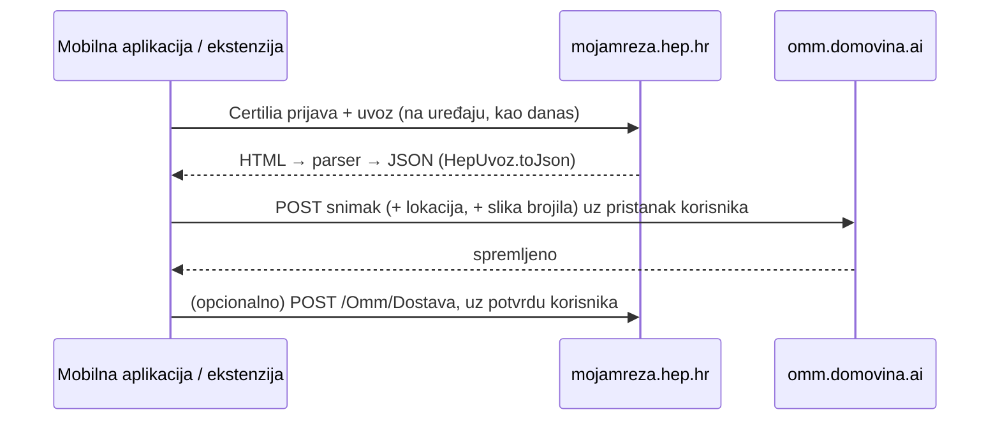

# omm.domovina.ai: servis koji sprema snimke OMM-ova

Stanje 2026-10-12: prva verzija je live na https://omm.domovina.ai (repo
`~/git/domovinatv/omm.domovina.ai`), a example app ima ekran „Očitaj brojilo“
i `dostavi()`. **Prioritet je da radi; sigurnost (dio „Kasnije“) dolazi
poslije.** Još nije isprobano na pravom brojilu ni stvarnom slanju HEP-u.

## Što i zašto

Web aplikacija (Astro na Cloudflare Workers, D1) na koju se korisnik prijavi i
spremi **snimak** svojih OMM-ova u određenom trenutku: popis OMM-ova, očitanja i
potrošnju. To su podaci za ponudu za fotonaponsku elektranu, a za korisnika je to
jednostavan očitavač struje.

- Repo: `~/git/domovinatv/omm.domovina.ai`, zaseban od ovoga. Ovaj repo ostaje
  biblioteka (plugin, ekstenzija, parser) bez korisničkih podataka; servis ima
  korisnike, bazu i osobne podatke.
- Uzor za setup: `domovinatv/podcast.domovina.ai` (Astro + `wrangler.jsonc`).
- Ne ide u `energy.domovina.ai` (Next.js, rok Green Energy Fair 28.–29.10.2026.,
  `main` je live). omm mu je izvor upita i povezuje se API-jem ili linkom.

## Tok podataka

- Server **nikad** ne ulazi na mojamreza.hep.hr i ne dobiva HEP kolačiće ni
  prijavu. Blokira ga CORS, a i ruši model povjerenja iz
  `2026-10-05-uvoz-arhitektura-i-povjerenje.md`.
- Upis očitanja u Moju mrežu (`POST /Omm/Dostava`) uvijek ide iz aplikacije u
  korisnikovoj sesiji i uz potvrdu.

## Mobilna aplikacija je glavni klijent

- **Kamera:** slika Iskra brojila, OCR registara **1.8.1** (viša tarifa) i
  **1.8.2** (niža tarifa). OCR na serveru, Workers AI
  `@cf/meta/llama-4-scout-17b-16e-instruct` (usporedba modela u
  `wrangler.jsonc` servisa).
  Rezultat se uvijek pokaže korisniku na potvrdu, jer bi krivo pročitana znamenka
  bila krivo očitanje kod HEP-a. Iskra prikaz se izmjenjuje, pa trebaju dvije
  slike (ili kratki video).
- **Lokacija:** GPS uz snimak daje mjesto elektrane, a time procjenu proizvodnje
  (npr. PVGIS) i podlogu za krov i orijentaciju. Adresa s HEP-a je obračunska i ne
  mora biti mjesto potrošnje.

## MVP (prvo ovo)

1. Astro + `@astrojs/cloudflare` + D1: jednostavna prijava, popis snimaka,
   brisanje računa.
2. `POST /api/snimak` prima JSON iz `HepUvoz.toJson()` (isti format daje
   `extension/uvoz.js`).
3. U ekstenziji i aplikaciji gumb „Pošalji na omm.domovina.ai“.
4. Faza 2: kamera + OCR, lokacija.

## Kasnije: sigurnost i autorizacija

Razmatrano 2026-10-12, odgođeno.

- **HEP-ova Certilia prijava nije prenosiva** na naš server: SAML odgovor je
  izdan za HEP, a NIAS je samo za javni sektor.
- **Ključno pravilo autorizacije: OMM pripada OIB-u.** OIB je na `/Postavke` u
  istoj tablici kao OMM (sada se namjerno ne uvozi, `lib/src/modeli.dart:3`).
  Server bi zapisivao samo ako je OIB snimka jednak OIB-u računa. Uvoz OIB-a
  traži izmjenu `kako-citamo-podatke.md` i GDPR privolu.
- **Vezanje OIB-a uz račun:** Certilia OIDC prijava za privatni sektor (provjeriti
  na developer.certilia.com postoji li i pod kojim uvjetima) ili jedan Certilia
  eSign potpis pri registraciji (OIB je u certifikatu).
- **Certilia potpis dokazuje tko, ne odakle.** Korisnik potpisuje ono što mu
  aplikacija pokaže. Potpisivanje svakog snimka je skupo (push + PIN, vjerojatno
  naplata po potpisu), a `certilia-esign` radi PAdES (PDF). Za JSON bi trebao
  JAdES/CAdES, što nije provjereno. Kvalificirani potpis ima smisla na ponudi ili
  ugovoru za elektranu.
- **Da su podaci s HEP-a:** App Attest (iOS) / Play Integrity (Android) dokazuju
  da je poslala naša nepromijenjena aplikacija, što je dovoljno. zkTLS/TLSNotary
  bi dao kriptografski dokaz izvora, ali je pretjeran.
- **Razina zaštite prema riziku:** korisnik nema razloga lagati o vlastitoj
  potrošnji jer bi dobio lošiju ponudu. Stvarni rizici su tuđi podaci i smeće u
  bazi.
- **GDPR:** OIB, adresa, OMM, lokacija. Treba privola sa svrhom („ponuda za FN
  elektranu“), rok čuvanja i „obriši moje podatke“.
- **Jedan ugovor za podatke:** parser postoji u Dartu i JS-u, a server je treći
  potrošač. Format JSON-a zapisati kao JSON Schema / zod i validirati ga na
  serveru.
