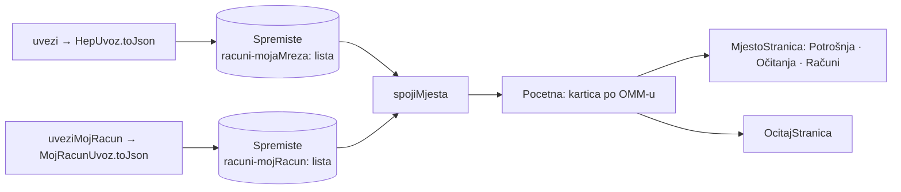

# Domovina Energy: brand i prikaz podataka u primjeru

13.10.2026. Primjer (`example/`) je preimenovan u **Domovina Energy** (0.5.0+7) i
preuređen. Plugin (`lib/`) nije diran.

## Odluke

| Pitanje | Odluka | Zašto |
|---|---|---|
| Ime i logo | Domovina Energy, logo s munjom iz `~/git/domovinatv/mediakit.domovina.tv/domovina_energy_logo_square.svg` | logo već postoji, ista obitelj kao energy.domovina.ai |
| Paleta | tokeni energy.domovina.ai (`tailwind.config.ts`, `docs/09-dizajn-sustav.md` tamo) | cream/forest/solar; zastava je već u logu, pa paleta ne treba biti „institucionalna“ navy |
| Pamćenje | N računa Moje mreže + M računa Mojeg računa, zadnji uvoz po računu u SharedPreferences | jedna osoba često vidi tuđa mjesta (roditelji, najam, firma); brisanje u Postavkama ili „Ukloni račun“ |

Pravila iz web sustava koja vrijede i ovdje: `forest` je jedina CTA boja,
`solar` (jantar) nosi samo podatak u kWh (nizak kontrast na bijelom, nikad gumb),
`rust` za greške. Sve boje su u `example/lib/tema.dart` (`Boje`); hex u widgetu ne.

## Struktura

- Model za prikaz (`podaci.dart`, `Mjesto`) gradi se **iz JSON-a** uvoza, ne iz
  Dart klasa plugina. Tako svježi i spremljeni uvoz idu istim putem, a plugin
  ne treba `fromJson`.
- Spajanje po OMM-u: kad oba izvora imaju isto očitanje (datum) ili razdoblje
  (`od`), vrijedi Moja mreža (mjerenje ODS-a); Moj račun dodaje predanu energiju,
  saldo i promet. Kupac bez OMM-a dobije ključ `kupac-<id>`.
- Više računa (od 2026-10-13): portali ne vraćaju korisničko ime ni OIB, pa je
  `Racun` prepoznat po mjestima koja vidi (OMM-ovi, odnosno `kupac_id`-evi). Novi
  uvoz zamjenjuje račun koji se osvježava i svaki koji dijeli bar jedno mjesto
  (isti račun s mjestom više ili manje). Ako dva računa vide isti OMM, u
  `spojiMjesta` vrijedi noviji uvoz. „Osvježi sve“ otvara prijavu za svaki račun
  redom, a odustajanje prekida niz. Stari ključevi `uvoz-<izvor>` sele se sami.
- „Poslano na omm.domovina.ai“ se pamti po računu i `dohvaceno` uvoza (`poslano`).
- Hrvatski zapis brojeva i datuma je `Hr` u `podaci.dart`, bez paketa `intl`.
- Graf potrošnje je `CustomPainter` (`widgets.dart`, `GrafPotrosnje`), bez `fl_chart`.

## Zamke

- **Fontovi**: Google Fonts CSS za curl i moderne preglednike daje samo `woff`.
  Statični TTF dobiješ s `-A "Wget/1.0"`:
  `curl -A "Wget/1.0" "https://fonts.googleapis.com/css2?family=Inter:wght@400;500;600;700&family=Fraunces:opsz,wght@9..144,600"`.
  Fontovi su u aplikaciji (`assets/fonts/`, s OFL licencama u `showLicensePage`),
  ne `google_fonts`, da prikaz ne šalje zahtjev nikome.
- **Ikona**: SVG iz mediakita ima `rx="32"` (prozirni kutovi). Za iOS ikonu
  makni `rx`, renderaj s bijelom pozadinom (`rsvg-convert -b white`) i
  `magick … -alpha off`, inače App Store/Xcode prigovara alfi.
- **`AppBar.bottom`** ne daje ograničenu visinu: `Spacer` u `Column` tamo pukne
  („non-zero flex but unbounded“). Fiksna visina reda + `MainAxisSize.min`.
- **`find.text` ne nalazi `Text.rich`** bez `findRichText: true`.
- **Ime pod ikonom** „Domovina Energy“ (15 znakova) iOS vjerojatno skraćuje.

## Pregled ekrana bez HEP prijave

Uvoz traži Certilia prijavu, pa su ekrani provjereni golden testom s pravim
fontovima: `FontLoader` za Inter/Fraunces i `MaterialIcons-Regular.otf` iz
`$FLUTTER/bin/cache/artifacts/material_fonts/`, `SharedPreferences.setMockInitialValues`
s oglednim JSON-om, `flutter test --update-goldens`. Test nije u repou (ovisi o
putu do Fluttera); obrazac je ovdje ako zatreba.

## Otvoreno

- Nije provjereno na uređaju s pravim uvozom (OTA 0.5.0+7 poslan 13.10.).
- Tamna tema ne postoji (`themeMode: light`), kao ni na webu.
- Launch screen je i dalje Flutterov placeholder.
- `tools/ios_ota.sh` ne zna za zaostali http.server / foreground `tailscale serve`
  (vidi memoriju o remote radu); 13.10. je stari serve na 443 ostao živ, pa je
  bilo dovoljno pokrenuti `http.server` s novim `web/` na 18765.

## Vezani dokumenti

- [Arhitektura uvoza i povjerenje](2026-10-05-uvoz-arhitektura-i-povjerenje.md)
- [omm.domovina.ai plan](2026-10-12-omm-domovina-ai-plan.md)
