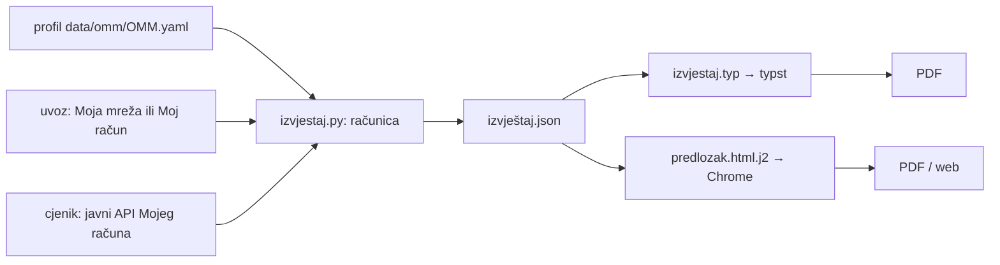

# Godišnji izvještaj potrošnje: računica, Typst, brend

Stanje 2026-10-13. Kod: `tools/izvjestaj/` (`izvjestaj.py`, `izvjestaj.typ`,
`predlozak.html.j2`). Profili, ulazni uvozi i PDF-ovi su u gitignored `data/omm/`
(sadrže imena, adrese i OMM-ove).

```bash
python3 tools/izvjestaj/izvjestaj.py data/omm/*.yaml                 # Typst PDF
python3 tools/izvjestaj/izvjestaj.py data/omm/<omm>.yaml --anonimno   # za dijeljenje
python3 tools/izvjestaj/izvjestaj.py data/omm/<omm>.yaml --html       # HTML + Chrome
```

## Tok



JSON je ugovor između računice i prikaza: brojevi su neformatirani, tekst
objašnjenja je gotov. Oba predloška čitaju isti JSON.

## Profil (YAML)

Portal daje OMM, adresu, korisnika, brojilo (samo Moja mreža), ugovorni račun
(samo Moj račun), tarifni model (samo Moja mreža) i očitanja. Profil dodaje:
`naziv`, `mjesto`, `opskrbljivac`, `prikljucak: {faza, snaga_kw}`, `lokacija:
{lat, lon}`, `tarifni_model` (za Moj račun), `dohvaceno` (izvoz jednog mjesta
ga nema), `rucna_ocitanja: [["YYYY-MM-DD HH:MM", T1], …]`, `fakturirano: {od,
do, iznos, racuna, izvor}` i slobodne `napomene`. Faza i priključna snaga ne
postoje ni na jednom portalu; upisuje ih korisnik.

## Računica

- Mjesečno = stanje brojila na prvi dan mjeseca, linearno između točaka.
- Točke su stvarna očitanja. Procjene ODS-a („Automatska procjena“,
  „Procijenjeno od strane ODS-a“, „preračunato“) i T1 = 0 se izbacuju, osim kad
  bez njih razdoblje nema početak ili kraj; tada se uzima najbliža procjena i
  tekst to kaže.
- Dva očitanja istog trenutka (npr. kupac i ODS na isti dan): vrijedi veće
  stanje. Isto stanje dostavljeno kasnije nije novo očitanje.
- Ručna očitanja (točan sat, decimale) zamjenjuju portalska očitanja istog dana.
  Pišu samo T1; T2 se uzima kao zadnji poznati.
- Mjesec je „raspodijeljen“ (šrafiran) ako dio njega pada u razmak dulji od 45
  dana ili ako dodiruje procjenu.
- Trošak po tarifnom modelu iz cjenika, prag 3.000 kWh po polugodištu (lis–ožu,
  tra–ruj) s +35 % samo na energiju. Cijene su današnje za cijelo razdoblje.
- Ako brojilo mjeri i NT (više od 1 %), računa se i drugi model; razlika ispod
  10 € godišnje piše se kao „praktički isto“.
- Stvarno fakturirano: iz profila ili iz prometa Mojeg računa. Poziv na broj
  nosi kraj obračunskog mjeseca (`…-260920-…` = rujan 2026.).

Provjera na četiri stvarna OMM-a: prijašnji ručno pisani izvještaji i
generator daju iste godišnje zbrojeve. Jedina razlika je +4 kWh kod jednog
mjesta, zbog pravila „veće stanje istog dana“.

## Zašto Typst, a ne HTML

Prva verzija bila je HTML (Jinja2) s grafovima kao SVG iz Pythona, ispisan u
PDF headless Chromeom. Typst ju je zamijenio kao zadani izlaz:

| | HTML + Chrome | Typst |
|---|---|---|
| izgled | Jinja + ~50 linija SVG-a u Pythonu + ljepilo za formatiranje | jedna datoteka od ~210 linija |
| PDF | 210–270 KB | 95–100 KB |
| prijelom | okvir s pozivom sam je preskočio na 3. stranicu | eksplicitan; tablice lome s ponovljenim zaglavljem |
| ovisnosti | Chrome, QR s CDN-a pri svakom ispisu | samo `typst`; paket `@preview/tiaoma` se preuzme jednom |
| web | ista stranica može biti web | samo PDF ili slika |

HTML ostaje kao `--html` jer je put do web verzije na omm.domovina.ai.
Odbačeno: matplotlib PDF (loš za tablice i tekst), ReportLab (svaka promjena
izgleda je puno koda). Typst je i preporuka za ponude i predračune.

## Zamke

- Typst čita samo datoteke ispod `--root`; skripta predaje apsolutnu putanju
  JSON-a uz `--root /`.
- Os grafa: korak se bira tako da ima najviše pet koraka. Stara logika dala je os
  do 200 uz stupce do 98.
- Hrvatsko rastavljanje riječi u Typstu ponavlja crticu na početku retka
  („PDV-“ / „-om“). To je pravopisno ispravno, ali neobično izgleda.

## Brend i dijeljenje

Izvještaj je zamišljen kao reklama za aplikaciju: traka s markom i QR kodom na
vrhu prve stranice, marka i broj stranice u podnožju, okvir „Izrađeno na …“ na
kraju. `--anonimno` skriva korisnika, brojilo i ugovorni račun, OMM skraćuje na
`01•••••693`, a adresu svodi na mjesto.

Od 2026-10-15 izvještaj nosi DOMOVINA brend iz `~/git/domovinatv/mediakit.domovina.tv`:
logo Domovina Energy (slovo „D“ s prugama zastave i munjom, kopija
`domovina_energy_logo_square.svg` u `tools/izvjestaj/domovina_energy_logo.svg`),
tamnoplava `#002F6C` za traku, glavnu seriju u grafovima i QR, a mrežarina je
prigušena crvena `#D9343A` (čista `#FF0000` je za logo, u stupcima je pretvrda).
omm.domovina.ai ostaje kao adresa uz marku, jer QR vodi tamo. Ako se logo u
mediakitu promijeni, kopiraj ga ponovno.

## Na omm.domovina.ai (od 2026-10-15)

Korisnik preuzima izvještaj za svaki svoj OMM na naslovnici omm.domovina.ai
(„Preuzmi PDF“ i „Za dijeljenje“ = anonimno). Tamo je prijepis ove skripte u
TypeScriptu (`src/lib/izvjestaj/izracun.ts`) i HTML predloška (`html.ts`); PDF
slaže Cloudflare Browser Rendering. Typst je otpao jer WASM kompajler s fontovima
ne stane u Worker. **Promjenu računice ili izgleda napravi u oba**, kao kod parsera.

Razlike od skripte: nema YAML profila, pa se mjesto izvodi iz adrese, opskrbljivač
iz toga postoji li uvoz s Hepija ili Mojeg računa, a lokacija iz očitanja sa slike.
Vlastita očitanja su snimci `rucno`/`foto` (T1 i T2, s točnim satom). Očitanja iz
svih uvoza istog ključa se spajaju; Hepi očitanja (sva „Elektra“, procjene se ne
razlikuju) koriste se samo kad drugog izvora nema. Izvještaj se računa pri svakom
preuzimanju, pa nakon novog očitanja ili uvoza nema što regenerirati. Web verzija
ima i dvije stvari koje skripta nema: kraće razdoblje kad povijest ne seže 12 mjeseci
unatrag i usporedbu s istim mjesecima godinu ranije. Za četiri
naša OMM-a daje iste brojke kao skripta (2026-10-15).

## Otvoreno

- Faza, priključna snaga i lokacija nedostaju za većinu OMM-ova.
- Mreža do 31.12.2025. bila je oko 13 % jeftinija; računica to ne uzima u obzir.

Vezani dokumenti: [hep-moj-racun-recept.md](hep-moj-racun-recept.md),
[kako-citamo-podatke.md](kako-citamo-podatke.md).
