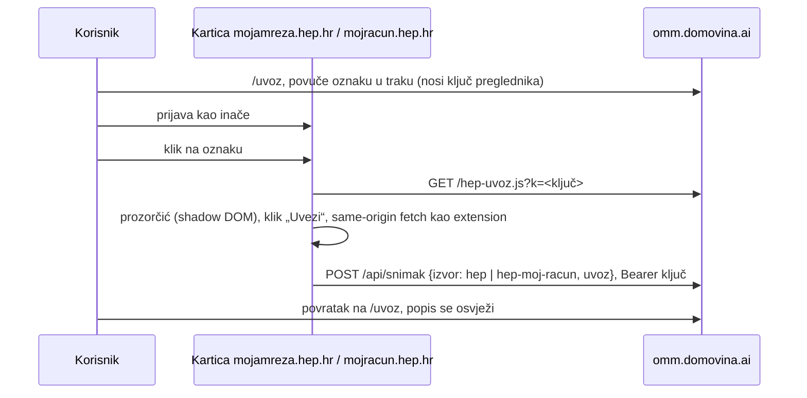

# Uvoz bez instalacije: bookmarklet i računi mailom

2026-10-14. Cilj: korisnik prenese podatke s HEP-a na omm.domovina.ai bez
aplikacije i bez extensiona.

## Zašto ne iframe

Ugraditi portal u našu stranicu i oko njega staviti gumbe ne može:

- `mojamreza.hep.hr` šalje `X-Frame-Options: SAMEORIGIN`, a
  `mojracun.hep.hr/elektra` šalje `X-Frame-Options: DENY` i
  `frame-ancestors 'none'`. Iframe ostaje prazan.
- Čak i bez toga Same-Origin Policy brani roditelju čitanje iframea s druge
  domene, a third-party cookieji (Safari, sve više Chrome) ruše prijavu u
  iframeu.

Svaki radni put mora izvršiti kod na HEP-ovom originu (WebView, extension,
bookmarklet) ili dobiti podatke od HEP-a bez portala (mail s računom).

## Bookmarklet

- Izvor: `extension/bookmarklet.js` (prozorčić, slanje, rezerva) +
  `uvoz.js` + `mojracun.js`. `npm run bookmarklet` u `extension/` ih spaja u
  `~/git/domovinatv/omm.domovina.ai/public/hep-uvoz.js`; zatim deploy tog repoa.
- Radi jer nijedan portal nema CSP za `script-src` ni `connect-src`
  (provjereno 2026-10-14), a `/api/snimak` ima CORS `*`. Provjereno u Braveu:
  skripta se učita, fetch prema omm.domovina.ai vraća 200, a prvi pravi uvoz s
  Moje mreže stigao je isti dan (1 OMM, 48 očitanja, 23 razdoblja; potrošnja
  za kolovoz ista kao na računu 8/2026).
- Rezerva ako HEP jednom uvede CSP: gumb „Pošalji preko nove kartice“ otvori
  `/uvoz?primi=1`, ta stranica javi `spreman` i primi tijelo snimka preko
  `postMessage` (provjerava `event.origin`). Zadnja rezerva je „Preuzmi JSON“.
- Loader u oznaci je kratak, a sav kod je u `hep-uvoz.js` s `?v=Date.now()`,
  pa popravak parsera ne traži novu oznaku. Cijena je povjerenje: kod se
  vuče sa servera pri svakom kliku (vidi „Čemu ipak vjeruješ“ u
  [kako-citamo-podatke.md](kako-citamo-podatke.md)).
- Mobitel: oznaka radi, ali ju je nespretno napraviti; aplikacija je tamo
  bolji put.

## Računi mailom

- HEP Elektra šalje račun s `hepi@hep.hr`, naslov „Obavijest o primitku
  računa“, PDF u prilogu (oko 1 MB).
- Adresa po korisniku: `racuni+<ključ>@omm.domovina.ai`. Email Routing ima
  catch-all samo na apexu, a domovina.ai mail ide na Google, zato poddomena
  `omm` s jednim pravilom `racuni@` → Worker i uključen subaddressing.
- Worker (`src/worker.ts` → `src/lib/mail.ts`): postal-mime, PDF prilozi,
  `src/lib/hep-racun.ts` (unpdf). Parser je prijepis
  `~/git/stepanic/rezije/scripts/parse-hep-racune.py`: redci se slažu iz
  položaja teksta da bi regexi za `pdftotext -layout` ostali isti. Na 19
  pravih računa daje isto kao Python.
- Račun se sprema kao snimak `hep-racun` (OMM, t1/t2 iz zadnjeg očitanja,
  `uvoz` = pročitani račun), duplikat po broju i iznosu. Tablica `mailovi`
  bilježi svaki mail; Gmailov kod potvrde prosljeđivanja prikazuje se na
  `/uvoz`.
- Ne čuva se PDF ni mail (OIB je na računu).

## Otvoreno

- Email Routing poddomena `omm`, subaddressing i pravilo `racuni@` → Worker
  traže potvrdu (zona domovina.ai, Google MX na apexu se ne dira).
- Uvoz s Mojeg računa preko oznake još nije isproban na pravoj prijavi.
- Očitanja s računa (`hep-racun`) još ne ulaze u usporedbu zadnjeg stanja
  (`src/lib/usporedba.ts`).
