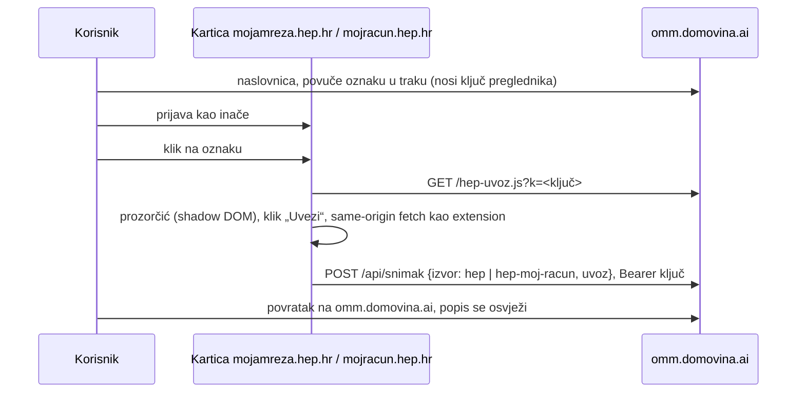

# Uvoz bez instalacije: bookmarklet i računi mailom

2026-10-14. Cilj: korisnik prenese podatke s HEP-a na omm.domovina.ai bez
aplikacije i bez extensiona.

## Zašto ne iframe

Ugraditi portal u našu stranicu i oko njega staviti gumbe ne može:

- `mojamreza.hep.hr` šalje `X-Frame-Options: SAMEORIGIN`, a
  `mojracun.hep.hr/elektra` šalje `X-Frame-Options: DENY` i
  `frame-ancestors 'none'`. Iframe ostaje prazan.
- Čak i bez toga Same-Origin Policy brani roditelju čitanje iframea s druge
  domene, a third-party cookieji (Safari, sve više Chrome) ruše prijavu u
  iframeu.

Svaki radni put mora izvršiti kod na HEP-ovom originu (WebView, extension,
bookmarklet) ili dobiti podatke od HEP-a bez portala (mail s računom).

## Odluka: oznaka je jedini put za korisnike (2026-10-14)

Naslovnica omm.domovina.ai nudi samo oznaku: tri koraka (povuci, prijavi se,
klikni) lakše je objasniti i pokazati nego aplikaciju ili extension, a ne
traži instalaciju. Mail sekcija je maknuta s naslovnice dok Email Routing nije
postavljen (backend ostaje), a očitanje sa slike je na `/ocitaj`. Flutter
plugin, example aplikacija i extension ostaju u repou: `extension/` drži
parsere od kojih se oznaka gradi.

Ključ preglednika je u localStorage-u originala omm.domovina.ai, pa je oznaka
vezana uz preglednik u kojem je povučena. Gumb „Otvori omm.domovina.ai“ u
prozorčiću zato otvara `/?k=<ključ oznake>`, da se uvozi vide i u drugom
pregledniku ili profilu.

## Bookmarklet

- Izvor: `extension/bookmarklet.js` (prozorčić, slanje, rezerva) +
  `uvoz.js` + `mojracun.js`. `npm run bookmarklet` u `extension/` ih spaja u
  `~/git/domovinatv/omm.domovina.ai/public/hep-uvoz.js`; zatim deploy tog repoa.
- Radi jer nijedan portal nema CSP za `script-src` ni `connect-src`
  (provjereno 2026-10-14), a `/api/snimak` ima CORS `*`. Provjereno u Braveu:
  skripta se učita, fetch prema omm.domovina.ai vraća 200, a prvi pravi uvoz s
  Moje mreže stigao je isti dan (1 OMM, 48 očitanja, 23 razdoblja; potrošnja
  za kolovoz ista kao na računu 8/2026).
- Rezerva ako HEP jednom uvede CSP: gumb „Pošalji preko nove kartice“ otvori
  `/?primi=1`, ta stranica javi `spreman` i primi tijelo snimka preko
  `postMessage` (provjerava `event.origin`). Zadnja rezerva je „Preuzmi JSON“.
- Loader u oznaci je kratak, a sav kod je u `hep-uvoz.js` s `?v=Date.now()`,
  pa popravak parsera ne traži novu oznaku. Cijena je povjerenje: kod se
  vuče sa servera pri svakom kliku (vidi „Čemu ipak vjeruješ“ u
  [kako-citamo-podatke.md](kako-citamo-podatke.md)).
- Mobitel: oznaka radi, ali ju je nespretno napraviti; aplikacija je tamo
  bolji put.

## Moj Hepi račun (HEP Opskrba)

Kupci HEP Opskrbe na tržištu (npr. „hepi bijeli“) imaju zaseban portal
`https://mojracun.hep.hr/hepi/`, sa zasebnom prijavom; Moj račun HEP Elektre
(`/elektra`) je za kupce u javnoj usluzi. Isti origin, pa bookmarklet bira
izvor po putanji.

- AngularJS (`app/js/app-bundleNN.js`), JSON API na `/hepi/api/`. Prijava
  (`POST korisnik/prijava`) sprema token u `localStorage['hepi.token']`;
  stranica ga šalje kao `Authorization: Bearer`. Osvježavanje stranice vraća
  na prijavu, ali token ostaje, pa API radi dok je kartica otvorena.
- Rute koje čitamo: `GET kupci` (objekt po `KupacId`, ima i OMM, šifru
  kupca, tarifni model, OIB i mail — zadnja dva ne uzimamo),
  `GET promet/:kupacId` (`Total` = saldo, `Racuni[]` s `Pnb` i `Link`,
  `Uplate[]`), `GET potrosnja/:kupacId` (`Potrosnja[]` mjesečno,
  `Ocitanja[]` s `NacinOcitanja`), i `POST report/racun {link}` koji vraća PDF
  računa (Content-Type kaže `text/html`, pa se provjerava `%PDF-`).
- Ostale rute iz bundlea (ne diramo): `saldo/:kupacId`,
  `kupac/:sifraKupca/racun/mail`, `kupac/:sifraKupca/proizvodnja`,
  `kupac/:kupacId/klub`, `nagrade/`, `korisnik/*`, `report/kupac`.
- Nema `X-Frame-Options` ni CSP (2026-10-14).
- Parser: `extension/hepi.js`, fixturei `test/fixtures/hepi/`. Snimak
  `hep-hepi` (`kupci[]` kao Moj račun). Nakon snimka bookmarklet pita
  `GET /api/racun` koje račune server već ima i šalje samo nove PDF-ove na
  `POST /api/racun`, gdje ih čita isti parser kao za mail i odbacuje PDF.
  Prvi prolaz 2026-10-14: 20 od 20 računa pročitano, od 2/2025 do 9/2026.
- Nema Dart parsera ni podrške u extensionu i aplikaciji; zasad samo
  bookmarklet.

## Računi mailom

- HEP Opskrba (Hepi) šalje račun s `hepi@hep.hr`, naslov „Obavijest o primitku
  računa“, PDF u prilogu (oko 1 MB).
- Adresa po korisniku: `racuni+<ključ>@omm.domovina.ai`. Email Routing ima
  catch-all samo na apexu, a domovina.ai mail ide na Google, zato poddomena
  `omm` s jednim pravilom `racuni@` → Worker i uključen subaddressing.
- Worker (`src/worker.ts` → `src/lib/mail.ts`): postal-mime, PDF prilozi,
  `src/lib/hep-racun.ts` (unpdf). Parser je prijepis
  `~/git/stepanic/rezije/scripts/parse-hep-racune.py`: redci se slažu iz
  položaja teksta da bi regexi za `pdftotext -layout` ostali isti. Na 19
  pravih računa daje isto kao Python.
- Račun se sprema kao snimak `hep-racun` (OMM, t1/t2 iz zadnjeg očitanja,
  `uvoz` = pročitani račun), duplikat po broju i iznosu. Tablica `mailovi`
  bilježi svaki mail; Gmailov kod potvrde prosljeđivanja prikazuje se na
  naslovnici (zasad skriveno, dok Email Routing nije postavljen).
- Ne čuva se PDF ni mail (OIB je na računu).

## Ponovljeni uvozi i duplikati (provjereno 2026-10-14)

- Ponovni klik na oznaku na istoj stranici samo pokaže postojeći prozorčić
  (gumb „Uvezi“ nestaje nakon uvoza), pa ništa ne šalje. Korisnikovo „poklikao
  sam puno puta“ zato nije ostavilo nijedan događaj; do servera stiže tek klik
  nakon osvježavanja stranice.
- Server: otisak snimka je sadržaj uvoza bez `dohvaceno` i bez datuma u
  `kupci[].saldo.opis` (Moj račun tamo piše „Dospjeli dug na dan <danas>:“,
  pa bi svaki dan bio nov snimak). Novo očitanje, račun ili uplata daju novi
  snimak (201), isti sadržaj vraća postojeći (200) i bilježi „duplikat“ u
  `dogadaji`. Provjereno ponovnim slanjem stvarnih uvoza s testnim ključem
  i stvarnim prijavama: 7 slanja → 1 novi snimak (Elektra, jednokratno zbog
  promjene otiska) i 6 duplikata.
- Hepi računi: oznaka pita `GET /api/racun` i šalje samo nove PDF-ove.

## Otvoreno

- Email Routing poddomena `omm`, subaddressing i pravilo `racuni@` → Worker
  traže potvrdu (zona domovina.ai, Google MX na apexu se ne dira).
- Očitanja s računa (`hep-racun`) još ne ulaze u usporedbu zadnjeg stanja
  (`src/lib/usporedba.ts`); Hepi očitanja (`hep-hepi`) ulaze.
- Mail sekcija je skrivena s naslovnice; vratiti je kad Email Routing radi
  (backend `/api/mail` i `email()` su deployani i lokalno testirani).
- Hepi nema Dart parser ni podršku u extension popupu (samo oznaka).
- Prozorčić nema „Uvezi ponovno“ bez osvježavanja stranice (ponuđeno, nije traženo).
- Ključ je po pregledniku: nema prijave, pa su uvozi iz dva preglednika pod
  dva ključa dok se ne otvori `/?k=` iz prozorčića.
- Desktop raspored naslovnice izmjeren samo na 1920×823 (bez scrolla); manji
  laptopi nisu provjereni.
