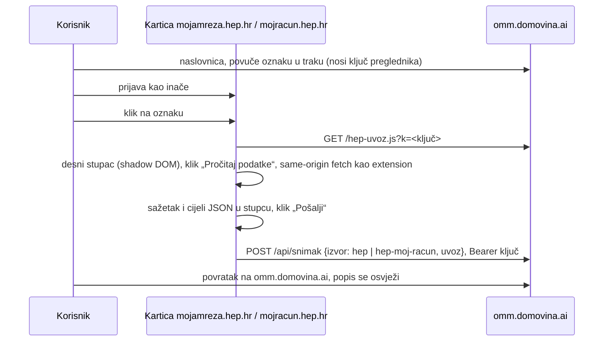
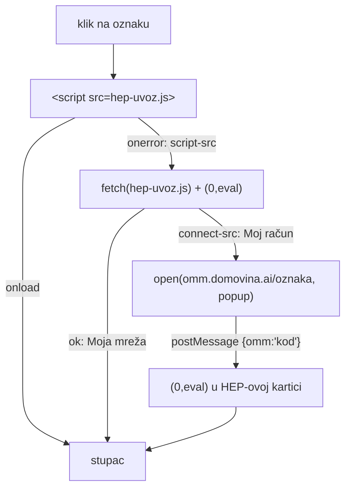
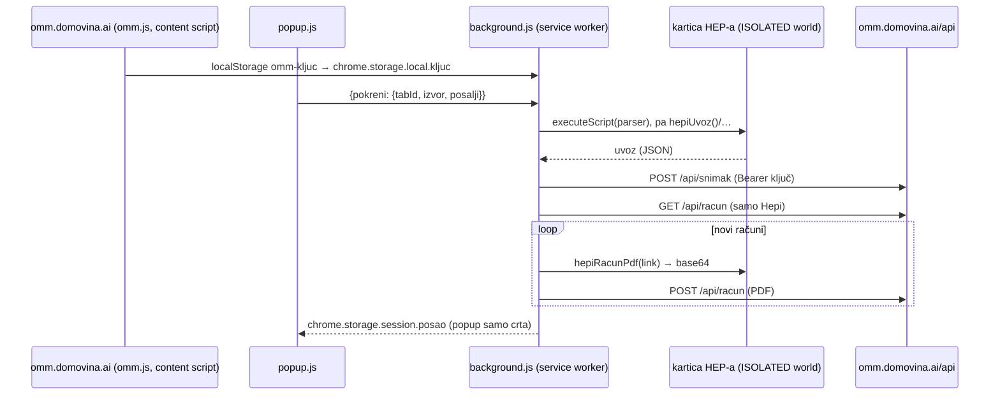

# Uvoz bez instalacije: bookmarklet i računi mailom

2026-10-14. Cilj: korisnik prenese podatke s HEP-a na omm.domovina.ai bez
aplikacije i bez extensiona.

## Zašto ne iframe

Ugraditi portal u našu stranicu i oko njega staviti gumbe ne može:

- `mojamreza.hep.hr` šalje `X-Frame-Options: SAMEORIGIN`, a
  `mojracun.hep.hr/elektra` šalje `X-Frame-Options: DENY` i
  `frame-ancestors 'none'`. Iframe ostaje prazan.
- Čak i bez toga Same-Origin Policy brani roditelju čitanje iframea s druge
  domene, a third-party cookieji (Safari, sve više Chrome) ruše prijavu u
  iframeu.

Svaki radni put mora izvršiti kod na HEP-ovom originu (WebView, extension,
bookmarklet) ili dobiti podatke od HEP-a bez portala (mail s računom).

## Odluka: oznaka je jedini put za korisnike (2026-10-14)

Naslovnica omm.domovina.ai nudi samo oznaku: tri koraka (povuci, prijavi se,
klikni) lakše je objasniti i pokazati nego aplikaciju ili extension, a ne
traži instalaciju. Mail sekcija je maknuta s naslovnice dok Email Routing nije
postavljen (backend ostaje), a očitanje sa slike je na `/ocitaj`. Flutter
plugin, example aplikacija i extension ostaju u repou: `extension/` drži
parsere od kojih se oznaka gradi.

Ključ preglednika je u localStorage-u originala omm.domovina.ai, pa je oznaka
vezana uz preglednik u kojem je povučena. Gumb „Otvori omm.domovina.ai“ u
prozorčiću zato otvara `/?k=<ključ oznake>`, da se uvozi vide i u drugom
pregledniku ili profilu.

## Bookmarklet



- Izvor: `extension/bookmarklet.js` (desni stupac, slanje, rezerva) +
  `uvoz.js` + `mojracun.js`. `npm run bookmarklet` u `extension/` ih spaja u
  `~/git/domovinatv/omm.domovina.ai/public/hep-uvoz.js`; zatim deploy tog repoa.
- Radilo je jer nijedan portal nije imao CSP za `script-src` ni `connect-src`
  (provjereno 2026-10-14; od 2026-10-22 imaju, vidi „HEP-ov CSP“ niže), a `/api/snimak` ima CORS `*`. Provjereno u Braveu:
  skripta se učita, fetch prema omm.domovina.ai vraća 200, a prvi pravi uvoz s
  Moje mreže stigao je isti dan (1 OMM, 48 očitanja, 23 razdoblja; potrošnja
  za kolovoz ista kao na računu 8/2026).
- Od 2026-10-15 je prikaz fiksni desni stupac pune visine (400 px) u izgledu
  omm.domovina.ai (znak B, tokeni iz `Tema.astro`, tema prati sustav). Prije
  čitanja kaže što čita (s popisom zahtjeva), što šalje i što ne dira; nakon
  čitanja pokaže sažetak po OMM-u i cijeli JSON koji bi otišao, a šalje tek na
  „Pošalji“. Na zaslonu od 1040 px naviše odmakne stranicu (`margin-right` na
  `<html>`), na užem leži preko nje. Gumbi su u podnožju stupca, uvijek vidljivi.
- `hep-uvoz.js` je čisti ASCII (`tools/bookmarklet.mjs` sve ostalo piše kao
  `\uXXXX`): server ga šalje kao `text/javascript` bez charseta, a Moj račun i
  Hepi ne šalju charset ni za stranicu, pa bi „č“ mogao ispasti „ÄŤ“.
- Rezerva ako HEP jednom uvede CSP: gumb „Pošalji preko nove kartice“ otvori
  `/?primi=1`, ta stranica javi `spreman` i primi tijelo snimka preko
  `postMessage` (provjerava `event.origin`). Zadnja rezerva je „Preuzmi JSON“.
- Loader u oznaci je kratak, a sav kod je u `hep-uvoz.js` s `?v=Date.now()`,
  pa popravak parsera ne traži novu oznaku. Cijena je povjerenje: kod se
  vuče sa servera pri svakom kliku (vidi „Čemu ipak vjeruješ“ u
  [kako-citamo-podatke.md](kako-citamo-podatke.md)).
- Mobitel: tehnički radi, ali ručno dodavanje oznake (kopiraj kod, uredi
  oznaku, zalijepi) korisnike je samo zbunjivalo. Od 2026-10-15 naslovnica na
  dodirnom zaslonu (`hover: none` i `pointer: coarse`) sakrije korake i kaže
  da se uvoz radi na računalu.

### Postavljanje oznake (2026-10-14)

Nijedan preglednik ne dopušta stranici da sama doda oznaku ni da uključi traku
s oznakama (Chrome je ukinuo `AddFavorite`, Firefox `sidebar.addPanel`), pa je
povlačenje jedini put u jednom potezu. Naslovnica ga olakšava:

- Prečac za traku samo za ovaj preglednik: ⌘⇧B na Macu, Ctrl+Shift+B drugdje;
  u Safariju se traka zove Favoriti.
- Dok se gumb povlači, pri vrhu stoji strelica „Pusti ga gore“ (`dragstart` i
  `dragend`). Uz gumb je mala CSS animacija povlačenja (isključena kod
  `prefers-reduced-motion` i na dodirnom zaslonu).
- Provjera: klik na oznaku dok si na omm.domovina.ai ne otvara prozorčić.
  `hep-uvoz.js` vidi da je na svom originu i javi događaj `omm-oznaka` s
  ključem oznake. Naslovnica pokaže „Oznaka je u traci, radi ✓“, a u
  `localStorage` (`omm-oznaka`) zapamti da je korak 1 gotov. Ako oznaka nosi
  drugi ključ (starija oznaka ili drugi profil), stranica ga preuzme preko
  `/?k=`, kao gumb „Otvori omm.domovina.ai“.
- Koraka su dva (od 2026-10-15; prije je klik na oznaku bio zaseban treći
  korak). Upute „prijavi se, klikni gumb u traci, pa Uvezi“ stoje u koraku 2
  **iznad** poveznica na portale: tko je prvo kliknuo portal, na HEP-u nije
  znao da treba kliknuti oznaku, jer uputa je bila tek u koraku 3. Kad je
  korak 1 gotov, kartica 1 samo potvrdi da je gumb u traci.
- Preglednik nema događaj „oznaka dodana“. Jedini signal pri povlačenju je
  `dataTransfer.dropEffect` u `dragend`: `none` je sigurno promašaj (pušten na
  stranicu ili Esc), pa stranica kaže da pokuša opet. Sve drugo znači samo da
  je gumb netko prihvatio (traka, adresna traka, drugi tab), pa stranica traži
  klik na oznaku za potvrdu. Testirano u Chromiumu sintetičkim događajem;
  pravo povlačenje u traku Safarija i Firefoxa nije provjereno.

## HEP-ov CSP (2026-10-22)

Oznaka je prestala raditi na Mojoj mreži i Mojem računu: HEP je uveo
`Content-Security-Policy`. Izmjereno `curl -sI` 2026-10-22:

| Portal | CSP |
|---|---|
| `mojamreza.hep.hr` | `script-src 'self' 'unsafe-eval' 'unsafe-inline' https://appdeum.hep.hr https://eusluge-nav(-test).gov.hr` (bez `connect-src`) |
| `mojracun.hep.hr/elektra/` | `frame-ancestors 'none'; script-src 'self' 'unsafe-inline' 'unsafe-eval'; connect-src 'self'` |
| `mojracun.hep.hr/` (naslovnica, Hepi) | nema |

Oba CSP-a dopuštaju `'unsafe-eval'` i `'unsafe-inline'` (pa i `javascript:`
oznake). Oznaka (`omm.domovina.ai/src/pages/index.astro`) zato proba redom:



- Uz `eval` nema `document.currentScript`, pa oznaka adresu s ključem ostavi u
  `window.ommOznaka`; `bookmarklet.js` je pročita i obriše.
- `/hep-uvoz.js` ima `Access-Control-Allow-Origin: *` (`public/_headers`), inače
  korak fetch pada i na Mojoj mreži.
- `/oznaka` šalje kod samo originima `mojamreza.hep.hr` i `mojracun.hep.hr`, a
  oznaka prima samo od `omm.domovina.ai` i samo od kartice koju je otvorila.
  Kod je javan; ključ ne putuje kroz karticu.
- Popup treba korisnički klik: otvara se odmah nakon dva neuspjela pokušaja
  (milisekunde, unutar aktivacije klika). Iz CDP-a bez klika `open` vraća `null`.
- Slanje na Mojem računu (`connect-src 'self'`) ide postojećom rezervom
  „Pošalji preko nove kartice“ (`/?primi=1`).
- **Stare oznake ne rade** dok se ne povuku ponovno: loader je u samoj oznaci.

Provjereno u Braveu 2026-10-22: Moja mreža (prijavljen) `script blocked → eval`,
stupac se otvori; Moj račun (stranica prijave) `script blocked → fetch blocked →
popup → eval`, stupac se otvori (testni gumb s pravim klikom, ne oznaka iz trake).
Pravi uvoz i slanje nakon promjene nisu ponovljeni.

### Pooštrenje 2026-10-30: bez eval, s COOP-om

Izmjereno `curl -sI` 2026-10-30:

| Portal | CSP | COOP |
|---|---|---|
| `mojamreza.hep.hr` | kao 22.10. (`'unsafe-eval' 'unsafe-inline'`, bez `connect-src`) | nema |
| `mojracun.hep.hr/elektra/` | `frame-ancestors 'none'; script-src 'self' 'unsafe-inline'; connect-src 'self'; object-src 'none'; base-uri 'self'` | `same-origin` |
| `mojracun.hep.hr/hepi/` | `frame-ancestors 'none'; script-src 'self' 'unsafe-inline' https://www.google.com https://www.gstatic.com; connect-src 'self'; object-src 'none'; base-uri 'self'` | `same-origin` |

Dvije promjene i što je puklo:

- **Nema `'unsafe-eval'`**: `(0,eval)(kod)` baca `EvalError`. Oznaka ga hvata i
  isti kod ubaci kao inline `<script>` (`textContent`), što `'unsafe-inline'`
  bez noncea dopušta. Druge greške se ne hvataju, da se kod ne izvrši dvaput.
- **COOP `same-origin`**: popup prema drugom originu nema `opener`, a HEP-ova
  strana izgubi referencu na njega. Zato su pukli i `/oznaka` kao popup i
  rezerva `/?primi=1`. Stara oznaka otvori `/oznaka` koja javi „Ova kartica
  služi oznaci…“ (od sada s uputom da se povuče nova).

Rješenje je skriveni **iframe** `omm.domovina.ai/oznaka?v=3` (COOP ne djeluje na
iframeove, a HEP-ov CSP nema `frame-src`). Middleware toj stranici postavlja
`frame-ancestors https://mojamreza.hep.hr https://mojracun.hep.hr` i ne šalje
`X-Frame-Options`; ostale stranice ostaju `DENY`.

```mermaid
sequenceDiagram
  participant H as HEP-ova stranica (oznaka, hep-uvoz.js)
  participant I as iframe omm.domovina.ai/oznaka
  participant A as omm.domovina.ai/api
  H->>I: stvori (fetch prema nama je pao)
  I->>A: GET /hep-uvoz.js
  I-->>H: postMessage {omm:'kod', kod}
  Note over H: eval, a na EvalError inline &lt;script&gt;
  H->>A: fetch /api/... (pada zbog connect-src)
  H-->>I: postMessage {omm:'zahtjev', id, put, metoda, tip, kljuc, tijelo}
  I->>A: fetch s Bearer ključem
  I-->>H: postMessage {omm:'odgovor', id, status, j}
```

- Oznaka iframe ostavi u `window.ommMost`. `hep-uvoz.js` ga uzme, a ako ga nema
  (kod je stigao kroz `<script>` ili `fetch`), napravi svoj. Spreman je kad javi `kod`.
- `bookmarklet.js` ima `api(put, metoda, tip, tijelo)`: izravni `fetch`, a na
  mrežnu grešku kroz most. Tako idu i snimak i PDF-ovi računa s Hepija.
- Most prima samo od HEP-ovih origina i samo od roditelja, i to samo
  `GET`/`POST` na `/api/snimak` i `/api/racun`.

Provjereno u Braveu 2026-10-30 pravim uvozom (nova oznaka iz trake, prijavljen):
Moj račun → novi snimak `hep-moj-racun`; Hepi → `hep-hepi` (duplikat, dakle
stigao); Moja mreža → `hep` (duplikat).

Ako HEP makne i `'unsafe-inline'`, oznaka više ne može izvršiti kod. Tada
ostaje ekstenzija (content script nije pod CSP-om stranice, a pozadina šalje
izravno) ili `domovina-browser` (`WKUserScript`).

Odbačeno: vlastiti Chromium (fork je ~100 GB checkouta i stalno praćenje
sigurnosnih zakrpa) i Electron/CEF (lako skida CSP kroz `onHeadersReceived`, ali
nosi cijeli Chromium, protivno razlogu za `domovina-browser`). Za Chromium
korisnike je dovoljna postojeća ekstenzija (`chrome.scripting` nije pod CSP-om
stranice). U `~/git/domovinatv/domovina-browser` (WKWebView) bi isto radio
`WKUserScript` u vlastitom `WKContentWorld` plus `messageHandlers` → `URLSession`
za slanje; nije napravljeno.

### Sljedeće: ekstenzija kao glavni put (odluka 2026-10-30)

HEP pooštrava korak po korak (22.10. CSP, 30.10. bez eval i s COOP-om), a oznaku
drži samo `'unsafe-inline'`. Zato ekstenzija postaje glavni put uvoza za Chromium
preglednike (Chrome, Brave, Edge, Opera), a oznaka ostaje za Safari i Firefox i
kao rezerva.

Zašto je ekstenzija otporna:

- `chrome.scripting.executeScript` (ISOLATED world) nije pod CSP-om stranice:
  ni `script-src` ni `eval` ni `unsafe-inline` je ne diraju.
- Slanje ide iz popupa ili service workera, s origina ekstenzije, pa HEP-ov
  `connect-src` i COOP nemaju ulogu (treba `host_permissions` za
  `https://omm.domovina.ai/*`, ili CORS `*` koji `/api/snimak` već ima).

Cijena:

- Instalacija je moguća samo preko Chrome Web Storea (inline instalacija ukinuta
  2018.): link s naslovnice → „Add to Chrome“ → dijalog s dozvolama.
  Developer račun stoji 5 USD jednokratno, a prvi pregled traje od nekoliko dana
  do tjedan.
- Manifest V3 zabranjuje udaljeni kod, pa popravak parsera zbog promjene HEP-ova
  API-ja čeka novi pregled. Oznaka se popravlja odmah (kod sa servera).
- Firefox (AMO) i Safari (Xcode omot, App Store) zasebno.

Stanje 2026-10-30 navečer: **v0.7.0** je napravljena (točke 1 do 4 iz handoffa),
učitana kao unpacked u Brave i povezana s ključem, i pravim uvozom provjerena na
sva tri portala (Brave, 17:06 do 17:25 UTC, D1 `dogadaji` 160 do 179):

| Portal | Rezultat |
|---|---|
| Hepi | snimak `hep-hepi` (duplikat, isti kao uvoz oznakom); nakon brisanja 3 računa poslana su točno ta 3 PDF-a, pročitana (2–4/2025). Ponovljeno uz popup zatvoren odmah nakon klika: sva 3 stigla, posao završi service worker. |
| Moj račun | snimak `hep-moj-racun` (duplikat) |
| Moja mreža | snimak `hep` novo, s očitanjem koje je iOS aplikacija predala HEP-u 14 min ranije (T1 15675, T2 9232, „Očitanje kupca“) |

Popravci nisu trebali.

Objava na Chrome Web Storeu (predano 2026-10-30, v0.7.1): [2026-10-30-chrome-web-store.md](2026-10-30-chrome-web-store.md).



Odluke i zašto:

- **Posao vodi service worker**, ne popup: klik izvan popupa ga zatvori, a Hepi
  zna imati 20 PDF-ova. Stanje je u `chrome.storage.session.posao`, popup ga crta
  i nakon ponovnog otvaranja. `executeScript` vraća samo JSON, pa PDF putuje kao
  base64.
- **Ključ preuzima content script `omm.js`** iz `localStorage['omm-kljuc']` stranice
  omm.domovina.ai (ne `#k=` iz adrese, SEC-01), i na `<html>` ostavlja
  `data-omm-ekstenzija` (verzija) i `data-omm-ekstenzija-povezana`. Web na promjenu
  ključa (`postaviKljuc`, rotacija) šalje događaj `omm-kljuc`. Nakon instalacije
  `onInstalled` otvori `omm.domovina.ai/?ekstenzija=1`. Odbačeno
  `externally_connectable`: web bi morao znati ID ekstenzije, a ovako ne mora.
  Bez ključa ili na 401 popup nudi „Otvori omm.domovina.ai“.
- **Bez `host_permissions`**: `activeTab` je dovoljan (klik na ikonu), a API ima CORS
  `*`. Uži dijalog dozvola, brži pregled. Dozvole: `activeTab`, `scripting`,
  `storage` i content script samo na `https://omm.domovina.ai/*`.
- Ikone iz znaka B (`tools/ikone.sh`, 128 ima 16 px ruba kako Store traži).
  `npm run zip` (`tools/zip.mjs`) popis čita iz manifesta, `popup.html` i
  `datoteka:` u `background.js`; `test/paket.test.js` to provjerava, da se ne
  ponovi `hepi.js` izvan paketa.
- Naslovnica: u Chromiumu s mišem (`navigator.userAgentData`, ne mobile) korak 1
  je „Dodaj u preglednik“ (Web Store), s poveznicom „Radije oznaka“
  (`localStorage omm-nacin`). Instalirana ekstenzija → „Ekstenzija je
  instalirana, povezana s ovim ključem ✓“ i korak 2 s uputom za ikonu. Gumb za
  Store se ne pokazuje dok je `WEB_STORE` u `omm.domovina.ai/src/lib/ekstenzija.ts`
  prazan. Zamka: Astro module skripta se izvrši kad je `readyState` već
  `interactive`, prije `DOMContentLoaded` na kojem `omm.js` označi vezu, pa se
  stanje crta dvaput.

Što je otvoreno:

1. Pravi uvoz kroz v0.7.0 na Hepiju (računi), Mojem računu i Mojoj mreži; provjera
   u D1 `dogadaji` (`snimak` i `racun`) i u popupu nakon zatvaranja usred posla.
2. `activeTab` i Hepi: grant traje dok kartica ne navigira. Hepi je SPA s `#!/`
   rutama; provjeriti da petlja PDF-ova ne izgubi pristup.
3. Materijal za Web Store (opis, snimke zaslona 1280×800, privatnost
   `omm.domovina.ai/privatnost`, obrazloženje dozvola), pa developer račun
   (5 USD) i upload: to radi korisnik. Nakon objave ID ide u `WEB_STORE`.
4. Sekcija „Kako to radi“ na naslovnici još opisuje samo oznaku.

## Moj Hepi račun (HEP Opskrba)

Kupci HEP Opskrbe na tržištu (npr. „hepi bijeli“) imaju zaseban portal
`https://mojracun.hep.hr/hepi/`, sa zasebnom prijavom; Moj račun HEP Elektre
(`/elektra`) je za kupce u javnoj usluzi. Isti origin, pa bookmarklet bira
izvor po putanji.

- AngularJS (`app/js/app-bundleNN.js`), JSON API na `/hepi/api/`. Prijava
  (`POST korisnik/prijava`) sprema token u `localStorage['hepi.token']`;
  stranica ga šalje kao `Authorization: Bearer`. Osvježavanje stranice vraća
  na prijavu, ali token ostaje, pa API radi dok je kartica otvorena.
- Rute koje čitamo: `GET kupci` (objekt po `KupacId`, ima i OMM, šifru
  kupca, tarifni model, OIB i mail — zadnja dva ne uzimamo),
  `GET promet/:kupacId` (`Total` = saldo, `Racuni[]` s `Pnb` i `Link`,
  `Uplate[]`), `GET potrosnja/:kupacId` (`Potrosnja[]` mjesečno,
  `Ocitanja[]` s `NacinOcitanja`), i `POST report/racun {link}` koji vraća PDF
  računa (Content-Type kaže `text/html`, pa se provjerava `%PDF-`).
- Ostale rute iz bundlea (ne diramo): `saldo/:kupacId`,
  `kupac/:sifraKupca/racun/mail`, `kupac/:sifraKupca/proizvodnja`,
  `kupac/:kupacId/klub`, `nagrade/`, `korisnik/*`, `report/kupac`.
- Nema `X-Frame-Options` ni CSP (2026-10-14).
- Parser: `extension/hepi.js`, fixturei `test/fixtures/hepi/`. Snimak
  `hep-hepi` (`kupci[]` kao Moj račun). Nakon snimka bookmarklet pita
  `GET /api/racun` koje račune server već ima i šalje samo nove PDF-ove na
  `POST /api/racun`, gdje ih čita isti parser kao za mail i odbacuje PDF.
  Prvi prolaz 2026-10-14: 20 od 20 računa pročitano, od 2/2025 do 9/2026.
- Nema Dart parsera ni podrške u extensionu i aplikaciji; zasad samo
  bookmarklet.

## Računi mailom

- HEP Opskrba (Hepi) šalje račun s `hepi@hep.hr`, naslov „Obavijest o primitku
  računa“, PDF u prilogu (oko 1 MB).
- Adresa po korisniku: `racuni+<ključ>@omm.domovina.ai`. Email Routing ima
  catch-all samo na apexu, a domovina.ai mail ide na Google, zato poddomena
  `omm` s jednim pravilom `racuni@` → Worker i uključen subaddressing.
- Worker (`src/worker.ts` → `src/lib/mail.ts`): postal-mime, PDF prilozi,
  `src/lib/hep-racun.ts` (unpdf). Parser je prijepis
  `~/git/stepanic/rezije/scripts/parse-hep-racune.py`: redci se slažu iz
  položaja teksta da bi regexi za `pdftotext -layout` ostali isti. Na 19
  pravih računa daje isto kao Python.
- Račun se sprema kao snimak `hep-racun` (OMM, t1/t2 iz zadnjeg očitanja,
  `uvoz` = pročitani račun), duplikat po broju i iznosu. Tablica `mailovi`
  bilježi svaki mail; Gmailov kod potvrde prosljeđivanja prikazuje se na
  naslovnici (zasad skriveno, dok Email Routing nije postavljen).
- Ne čuva se PDF ni mail (OIB je na računu).

## Ponovljeni uvozi i duplikati (provjereno 2026-10-14)

- Ponovni klik na oznaku na istoj stranici samo pokaže postojeći stupac
  (nakon slanja ostaju samo „Otvori omm.domovina.ai“ i „Zatvori“), pa ništa ne šalje.
- Kad server vrati `duplikat`, stupac piše „Nema ništa novo“ s vremenom prvog
  uvoza (`stvoren`) i objašnjenjem da novi snimak donosi tek novo očitanje,
  račun ili uplata. Stari tekst „Isti uvoz je već bio na omm.domovina.ai“
  zvučao je kao greška (Matija, 2026-10-15).
- Stupac skrola svoj `.tijelo` (`scrollTo` po `offsetTop`), ne stranicu:
  `scrollIntoView` iz zatvorenog shadow roota nije pomaknuo stupac do poruke. Korisnikovo „poklikao
  sam puno puta“ zato nije ostavilo nijedan događaj; do servera stiže tek klik
  nakon osvježavanja stranice.
- Server: otisak snimka je sadržaj uvoza bez `dohvaceno` i bez datuma u
  `kupci[].saldo.opis` (Moj račun tamo piše „Dospjeli dug na dan <danas>:“,
  pa bi svaki dan bio nov snimak). Novo očitanje, račun ili uplata daju novi
  snimak (201), isti sadržaj vraća postojeći (200) i bilježi „duplikat“ u
  `dogadaji`. Provjereno ponovnim slanjem stvarnih uvoza s testnim ključem
  i stvarnim prijavama: 7 slanja → 1 novi snimak (Elektra, jednokratno zbog
  promjene otiska) i 6 duplikata.
- Hepi računi: oznaka pita `GET /api/racun` i šalje samo nove PDF-ove.

## Otvoreno

- Email Routing poddomena `omm`, subaddressing i pravilo `racuni@` → Worker
  traže potvrdu (zona domovina.ai, Google MX na apexu se ne dira).
- Očitanja s računa (`hep-racun`) još ne ulaze u usporedbu zadnjeg stanja
  (`src/lib/usporedba.ts`); Hepi očitanja (`hep-hepi`) ulaze.
- Mail sekcija je skrivena s naslovnice; vratiti je kad Email Routing radi
  (backend `/api/mail` i `email()` su deployani i lokalno testirani).
- Hepi nema Dart parser ni podršku u extension popupu (samo oznaka).
- Prozorčić nema „Uvezi ponovno“ bez osvježavanja stranice (ponuđeno, nije traženo).
- Ključ je po pregledniku: nema prijave, pa su uvozi iz dva preglednika pod
  dva ključa dok se ne otvori `/?k=` iz prozorčića.
- Desktop raspored naslovnice izmjeren samo na 1920×823 (bez scrolla); manji
  laptopi nisu provjereni.
